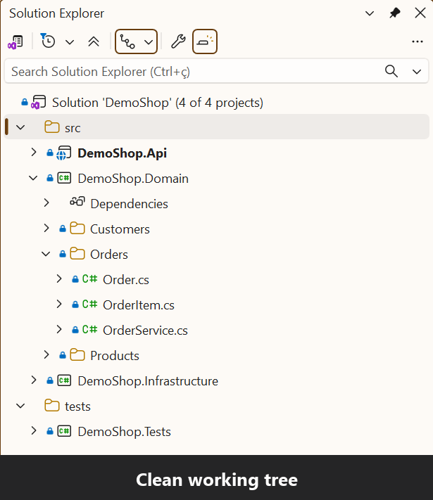

# Folder Git Status

Visual Studio extension that colors the folders, projects, solution folders and files that contain Git changes in **Solution Explorer**.

Visual Studio shows a glyph on a changed file, but nothing on the folders above it. With this extension the whole tree inherits the state of the files inside it: if a file three levels down is modified, every folder up to the solution is colored.



## Colors

| Color (default) | Meaning |
|---|---|
| 🔴 Red | Contains modified, deleted or renamed files |
| 🟢 Green | Contains only new files (added or untracked) |
| 🟠 Amber | Contains files with merge conflicts |

When a folder has changes of different kinds, the most severe one wins: conflict > modified > new.

### Branch changes

With **Show branch changes** on, items changed by the commits of the current branch are also colored, in a lighter tone of the same colors. This shows everything the branch touched since it left the base branch (useful when reviewing a pull request or coming back to a feature), not only what is still uncommitted.


Uncommitted changes always keep the full color and take precedence: a folder with pending changes is shown in full color even if the branch also committed changes inside it.

The base branch is detected from the remote's default branch (`origin/HEAD`), falling back to `origin/main`, `origin/master`, `main` or `master`, or can be set in the options. A base branch set in the options applies to every repository; where it does not exist, the automatic detection is used. The comparison is `git diff <base>...HEAD`, so commits that only exist on the base branch are not counted.


## Features

- Optional branch mode: also shows, in a lighter tone, what the commits of the current branch changed compared to the base branch.
- Recursive propagation up to the root: physical folders, projects, solution folders (including `.slnx`) and the solution node.
- Automatic refresh when files are saved, created, deleted or renamed, and on stage, commit, checkout or merge.
- Multiple repositories and submodules in the same solution.
- Also works in *Open Folder* mode.
- Folders that change all the time (`bin`, `obj`, `.vs`, `node_modules`) are ignored, so builds don't trigger refreshes.

## Requirements

- Visual Studio 2022 (17.14 or later) or Visual Studio 2026, x64 or Arm64.
- Git installed (on the `PATH`, or with its path set in the options).

## Settings

Under **Tools > Options > Folder Git Status > General**:

| Option | Default | Description |
|---|---|---|
| Enabled | True | Turns the extension on or off |
| Colorize files | True | Also colors the names of changed files |
| Bold | False | Shows items with changes in bold |
| Modified / Added / Conflict | Red / Green / Amber | Color for each status |
| Committed changes opacity (%) | 55 | Opacity of the colors for changes that are only in commits of the branch |
| Show branch changes | False | Also colors the items changed by the commits of the current branch |
| Base branch | *(empty)* | Branch to compare with; empty detects it automatically |
| Git executable | `git` | Path to `git.exe` |
| Diagnostic log | False | Writes details to the Output window and to `%LOCALAPPDATA%\FolderGitStatus\log.txt` |


## How it works

Visual Studio has no public API to decorate Solution Explorer items. The extension:

1. Runs `git --no-optional-locks status --porcelain=v1 -z` in the background and computes each folder's status from the changed files. With branch changes on, it also runs `git diff --name-status -z <base>...HEAD`.
2. Watches the working tree and the Git index with `FileSystemWatcher` and reruns the status (debounced) when something changes.
3. Finds the Solution Explorer tree and, for each visible item, resolves its physical path through `IVsHierarchy` and colors the name text.

## Known limitations

- Items linked into a project from outside the project folder are not considered.
- On the selected item, the text color is drawn over the selection highlight.
- In worktrees (when `.git` is a file), stage-only changes show up only after another working tree file changes.
- The integration relies on the internal structure of Solution Explorer, which may change in future Visual Studio versions. If the colors stop showing, turn on *Diagnostic log* and open an issue with the log contents.

## Building

Requires the **Visual Studio extension development** workload.

```powershell
& "C:\Program Files\Microsoft Visual Studio\18\Community\MSBuild\Current\Bin\MSBuild.exe" FolderGitStatus.slnx -restore -p:Configuration=Release
```

The installer is produced at `src\FolderGitStatus\bin\Release\net48\FolderGitStatus.vsix`. To debug, open `FolderGitStatus.slnx` and press F5: the project starts an experimental instance (`/rootsuffix Exp`) with the extension installed.

## Repository layout

```
├── src/FolderGitStatus/        VSIX project
│   ├── Git/                    git status, file watching and per-folder propagation
│   ├── SolutionExplorer/       Solution Explorer tree discovery and painting
│   ├── Resources/              extension icon
│   ├── FolderGitStatusPackage.cs
│   ├── OptionsPage.cs
│   └── source.extension.vsixmanifest
├── docs/images/                screenshots and demo GIF used by this README and the Marketplace page
├── publishManifest.json        Marketplace metadata (VsixPublisher)
└── FolderGitStatus.slnx
```

## Changelog

See [CHANGELOG.md](https://github.com/Lompzx/FolderGitStatus/blob/main/CHANGELOG.md).

## License

[MIT](LICENSE)
