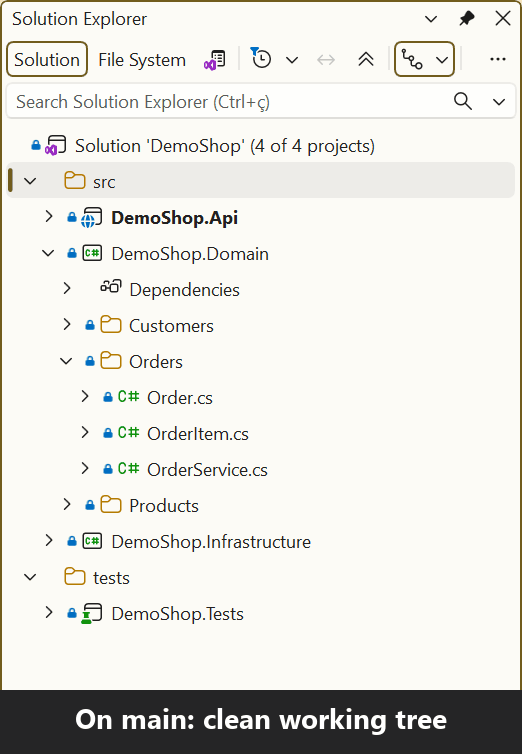
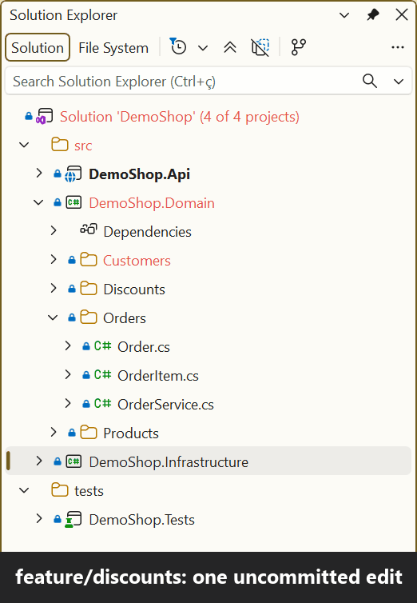
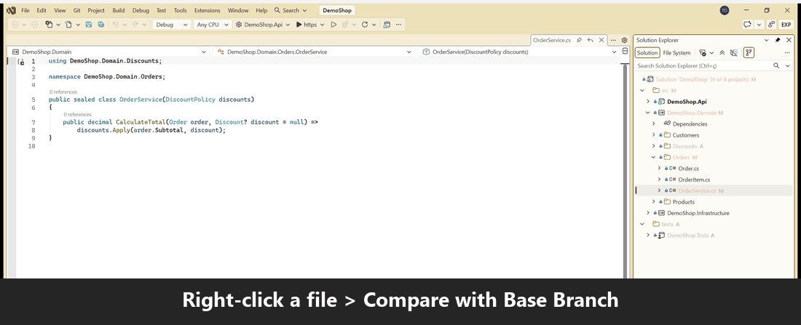
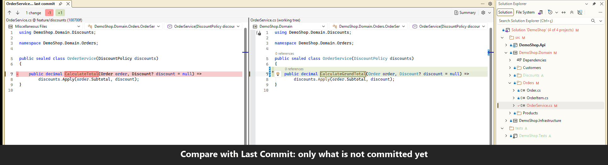
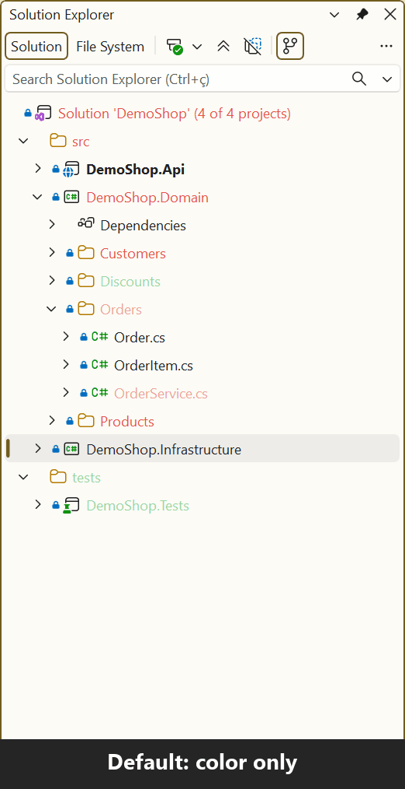
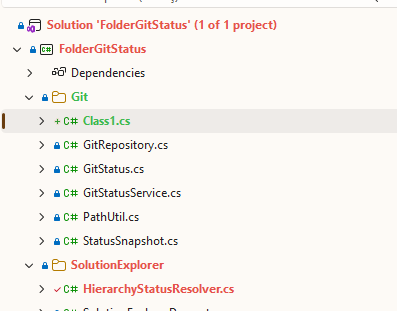
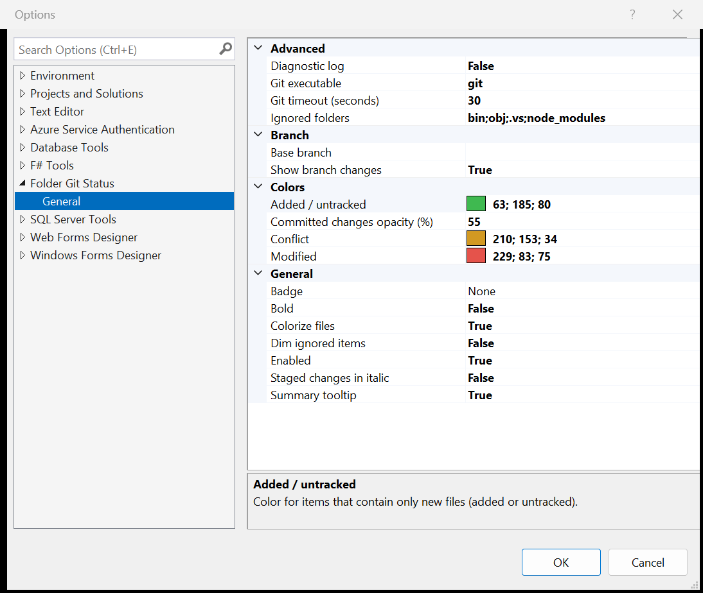

# Folder Git Status

Visual Studio extension that colors the folders, projects, solution folders and files that contain Git changes in **Solution Explorer**.

Visual Studio shows a glyph on a changed file, but nothing on the folders above it. With this extension the whole tree inherits the state of the files inside it: if a file three levels down is modified, every folder up to the solution is colored.


## Colors

| Color (default) | Meaning |
|---|---|
| 🔴 Red | Contains modified, deleted or renamed files |
| 🟢 Green | Contains only new files (added or untracked) |
| 🟠 Amber | Contains files with merge conflicts |

When a folder has changes of different kinds, the most severe one wins: conflict > modified > new.

### Branch changes

With **Show branch changes** on, items changed by the commits of the current branch are also colored, in a lighter tone of the same colors. This shows everything the branch touched since it left the base branch (useful when reviewing a pull request or coming back to a feature), not only what is still uncommitted.



Uncommitted changes always keep the full color and take precedence: a folder with pending changes is shown in full color even if the branch also committed changes inside it.

The base branch is, in this order:

1. The one set for the repository with `git config foldergitstatus.baseBranch <branch>` (useful for Git Flow repositories that branch off `develop`).
2. The one set in the options. It applies to every repository; where it does not exist, the next ones are used.
3. The remote's default branch (`origin/HEAD`), falling back to `origin/main`, `origin/master`, `main` or `master`.

The comparison is `git diff <base>...HEAD`, so commits that only exist on the base branch are not counted.

### Toolbar button and Branch Changes filter

**Show Branch Changes** is also a button on the Solution Explorer toolbar (if the toolbar is narrow, it is in its `...` overflow menu); its tooltip shows the base branch in use. The Solution Explorer filter drop-down gets a **Branch Changes Filter**, next to the built-in *Pending Changes Filter*: it shows only the files the branch changed, committed or not, and follows new edits, commits and checkouts while it is on.



### Compare with Base Branch

Right-click a file in Solution Explorer and choose **Compare with Base Branch** to open the Visual Studio diff between the version of the file where the branch started (the merge base with the base branch) and the working tree. Files renamed on the branch are compared with their original name; files created on the branch are compared with an empty file.



### Compare with Last Commit and Compare with Previous Commit

Two more commands on the context menu of a file, for the changes of the branch one step at a time:

- **Compare with Last Commit**: the last commit (`HEAD`) against the working tree, so the diff shows only what is not committed yet, staged or not. It shows up on files with uncommitted changes; new files are compared with an empty file.
- **Compare with Previous Commit**: what the last commit that changed the file did to it (the file before and after that commit, merge commits skipped). The commit message is in the header of the diff. It shows up on files that are already in a commit.

Both follow renames, like *Compare with Base Branch*.



### Badges, staged changes and ignored files

- **Badge**: shows a letter (`M`, `A`, `C`) or, for folders, the number of changed files after the name, so the status does not depend on the color alone.
- **Summary tooltip**: hovering a changed item shows how many files are modified, new or in conflict, uncommitted and committed on the branch.
- **Staged changes in italic**: items whose changes are all staged (`git add`) are shown in italic.
- **Dim ignored items**: items ignored by Git (`.gitignore`, `.git/info/exclude`) are shown dimmed.





## Features

- Optional branch mode: also shows, in a lighter tone, what the commits of the current branch changed compared to the base branch, with a toolbar button, a Solution Explorer filter and a *Compare with Base Branch* command.
- *Compare with Last Commit* (only the uncommitted changes) and *Compare with Previous Commit* (what the last commit changed) on the context menu of a file.
- Optional badges (letter or file count), summary tooltip, italic for staged changes and dimmed ignored files.
- Recursive propagation up to the root: physical folders, projects, solution folders (including `.slnx`) and the solution node.
- Automatic refresh when files are saved, created, deleted or renamed, and on stage, commit, checkout or merge.
- Multiple repositories, submodules and worktrees in the same solution, including additional *New Solution Explorer View* windows.
- Also works in *Open Folder* mode.
- Folders that change all the time (`bin`, `obj`, `.vs`, `node_modules`, configurable) are ignored by the file watcher, so builds don't trigger refreshes.
- On a strong selection highlight, the selected item keeps the theme's text color so it stays readable.
- If git cannot be run, an info bar says so and links to the option with its path; git commands that hang are stopped after a timeout.

## Requirements

- Visual Studio 2022 (17.14 or later) or Visual Studio 2026, x64 or Arm64.
- Git installed (on the `PATH`, or with its path set in the options).

## Settings

Under **Tools > Options > Folder Git Status > General**:

| Option | Default | Description |
|---|---|---|
| Enabled | True | Turns the extension on or off |
| Colorize files | True | Also colors the names of changed files |
| Bold | False | Shows items with changes in bold |
| Badge | None | `Letter`: M, A or C after the name. `Count`: the number of changed files inside each folder (files show the letter) |
| Summary tooltip | True | Hovering a changed item shows a summary of its changes |
| Staged changes in italic | False | Shows in italic the items whose changes are all staged |
| Dim ignored items | False | Shows the items ignored by Git dimmed |
| Modified / Added / Conflict | Red / Green / Amber | Color for each status |
| Committed changes opacity (%) | 55 | Opacity of the colors for changes that are only in commits of the branch |
| Show branch changes | False | Also colors the items changed by the commits of the current branch |
| Base branch | *(empty)* | Branch to compare with; empty detects it automatically. `git config foldergitstatus.baseBranch` takes precedence for a repository |
| Git executable | `git` | Path to `git.exe` |
| Git timeout (seconds) | 30 | A git command that takes longer is stopped |
| Ignored folders | `bin;obj;.vs;node_modules` | Folders whose changes do not trigger a refresh |
| Diagnostic log | False | Writes details to the Output window and to `%LOCALAPPDATA%\FolderGitStatus\log.txt` |



## How it works

Visual Studio has no public API to decorate Solution Explorer items. The extension:

1. Runs `git --no-optional-locks status --porcelain=v1 -z` in the background and computes each folder's status from the changed files. With branch changes on (or the Branch Changes filter), it also runs `git diff --name-status -z <base>...HEAD`.
2. Watches the working tree and the Git directory with `FileSystemWatcher` and reruns the status (debounced) when something changes. In worktrees and submodules, where `.git` is a file, the actual Git directory is watched too.
3. Finds the Solution Explorer tree and, for each visible item, resolves its physical path through `IVsHierarchy`, colors the name text and draws the badge as an adorner.

## Known limitations

- Items linked into a project from outside the project folder are not considered.
- The *Compare with* commands are available on files of projects and solutions, not in *Open Folder* mode.
- The integration relies on the internal structure of Solution Explorer, which may change in future Visual Studio versions. If the colors stop showing, turn on *Diagnostic log* and open an issue with the log contents.

## Building

Requires the **Visual Studio extension development** workload.

```powershell
& "C:\Program Files\Microsoft Visual Studio\18\Community\MSBuild\Current\Bin\MSBuild.exe" FolderGitStatus.slnx -restore -p:Configuration=Release
```

The installer is produced at `src\FolderGitStatus\bin\Release\net48\FolderGitStatus.vsix`. To debug, open `FolderGitStatus.slnx` and press F5: the project starts an experimental instance (`/rootsuffix Exp`) with the extension installed.

The unit tests (parsing of the git output and the status rules) don't need Visual Studio:

```powershell
dotnet test tests/FolderGitStatus.Tests
```

GitHub Actions builds the VSIX and runs the tests on every push; pushing a `v*` tag also publishes it to the Marketplace (needs the `VS_MARKETPLACE_PAT` secret).

## Repository layout

```
├── src/FolderGitStatus/        VSIX project
│   ├── Git/                    git status, file watching and per-folder propagation
│   ├── SolutionExplorer/       Solution Explorer tree discovery, painting, badges and the Branch Changes filter
│   ├── Resources/              extension icon
│   ├── Commands.cs             toolbar button and the Compare with commands
│   ├── FolderGitStatusPackage.cs
│   ├── FolderGitStatusPackage.vsct
│   ├── OptionsPage.cs
│   └── source.extension.vsixmanifest
├── tests/FolderGitStatus.Tests/ unit tests (xUnit)
├── .github/workflows/          build, test and Marketplace publishing
├── docs/images/                screenshots and demo GIFs used by this README and the Marketplace page
├── publishManifest.json        Marketplace metadata (VsixPublisher)
└── FolderGitStatus.slnx
```

## Changelog

See [CHANGELOG.md](https://github.com/Lompzx/FolderGitStatus/blob/main/CHANGELOG.md).

## License

[MIT](LICENSE)
